# Artwork-WEB
Remix the masters into new artwork, hang it on a virtual wall, and download it.

Artwork-WEB is the browser version of
[artwork-tui](https://github.com/andri-berger/artwork-tui). It generates
abstract artwork out of plain HTML and CSS: hundreds of boxes, lines and
shapes, filled with colors, gradients or classic paintings, then run through
WebGL filters. Every single value behind the picture lives in a spreadsheet,
so you can start with one click on **GENERATE ART** and then change anything
down to a single pixel.

- **No backend.** It's static files plus a few frontend libraries. Nothing is
  uploaded and nothing is fetched from the internet; the local setup never
  talks to print-artwork.com.
- **Your work is kept.** Sliders, tables, chosen painting and uploaded images
  are saved in your browser (`localStorage` and IndexedDB) and come back after
  a refresh.
- **Print-ready output.** DOWNLOAD renders the artwork again at 5× screen
  resolution and saves it as a PNG.

**Quick start** (macOS/Linux, needs `python3` 3.7+, ~1.4 GB download):

```bash
curl -fsSL https://raw.githubusercontent.com/andri-berger/artwork-web/main/install.sh | sh
artwork-web --open
```

Then click **GENERATE ART**. Options, updating and troubleshooting are under
[Installation](#installation).

## Demos

<table>
    <tr>
        <td width="50%" valign="top"><a href="docs/demos/01-generate-art.png">
        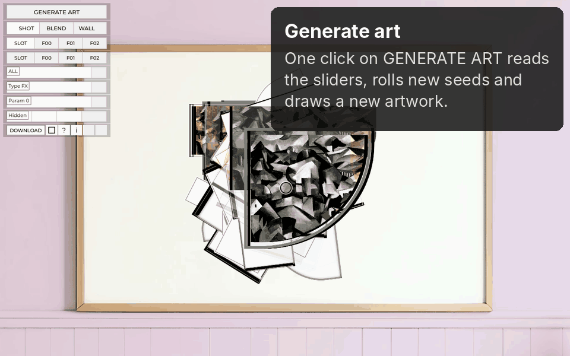</a></td>
        <td width="50%" valign="top"><a href="docs/demos/02-seed-locks.png">
        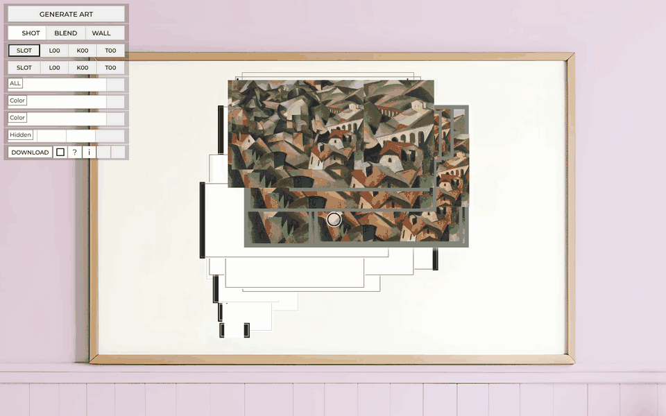</a></td>
    </tr>
    <tr>
        <td width="50%" valign="top"><a href="docs/demos/03-rooms.png">
        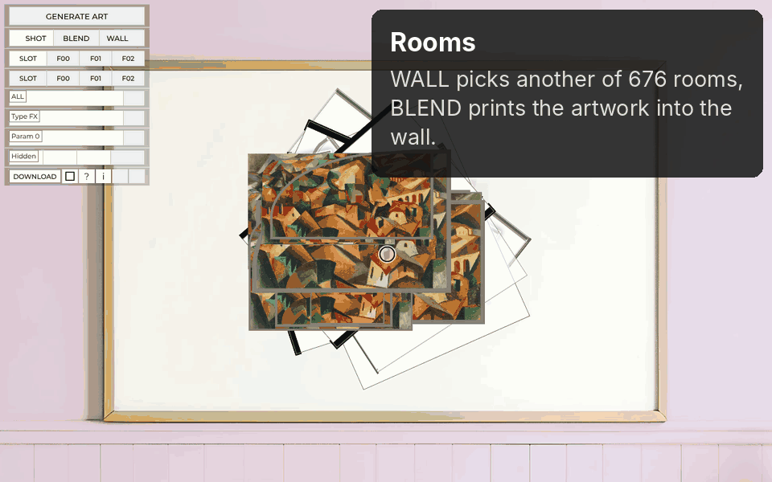</a></td>
        <td width="50%" valign="top"><a href="docs/demos/04-three-views.png">
        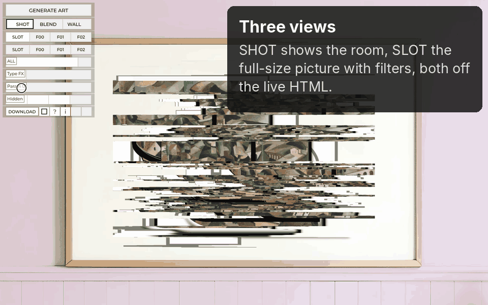</a></td>
    </tr>
    <tr>
        <td width="50%" valign="top"><a href="docs/demos/05-element-randomizer.png">
        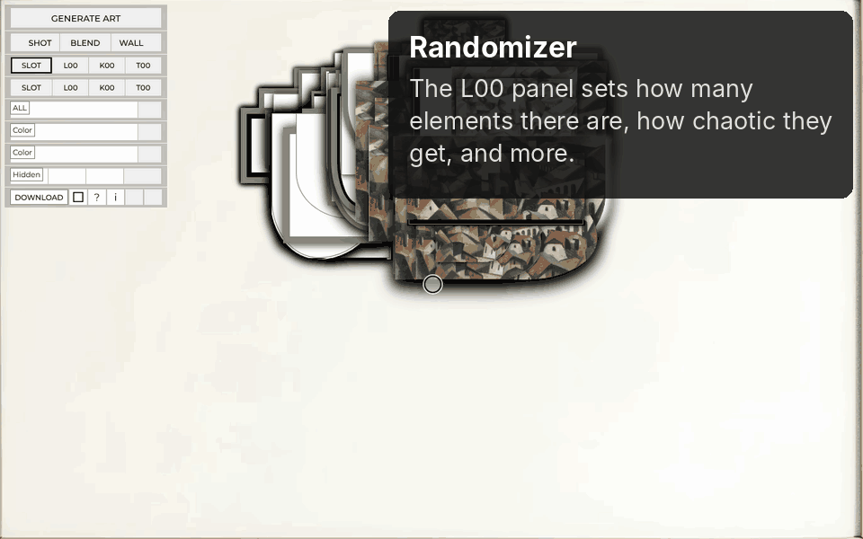</a></td>
        <td width="50%" valign="top"><a href="docs/demos/06-work-is-kept.png">
        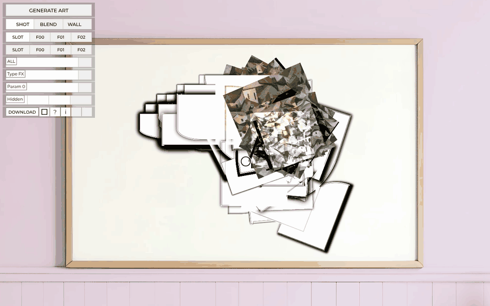</a></td>
    </tr>
</table>
<table>
    <tr>
        <td width="33%" valign="top"><a href="docs/demos/07-creative-fx.png">
        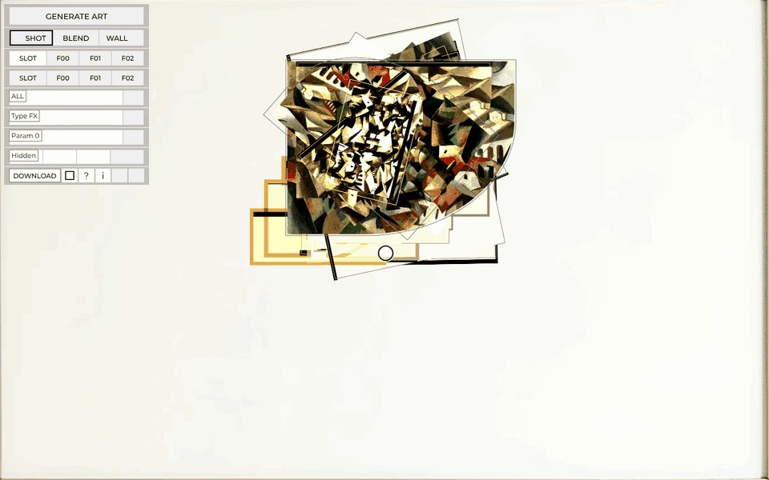</a></td>
        <td width="33%" valign="top"><a href="docs/demos/08-granular-filter.png">
        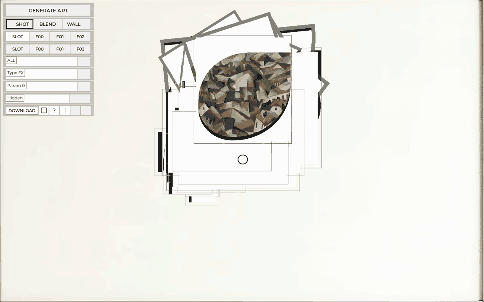</a></td>
        <td width="33%" valign="top"><a href="docs/demos/09-painting-browser.png">
        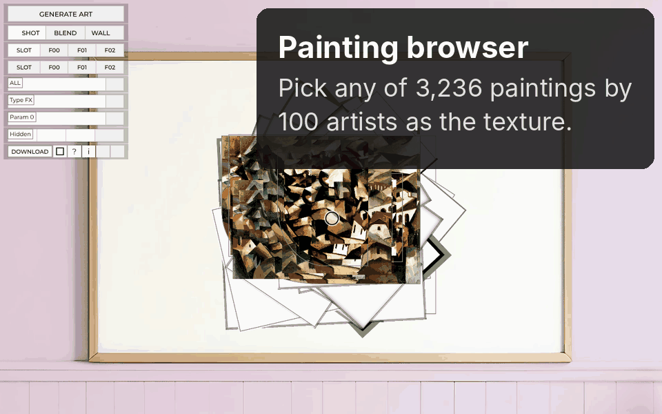</a></td>
    </tr>
    <tr>
        <td width="33%" valign="top"><a href="docs/demos/10-own-images.png">
        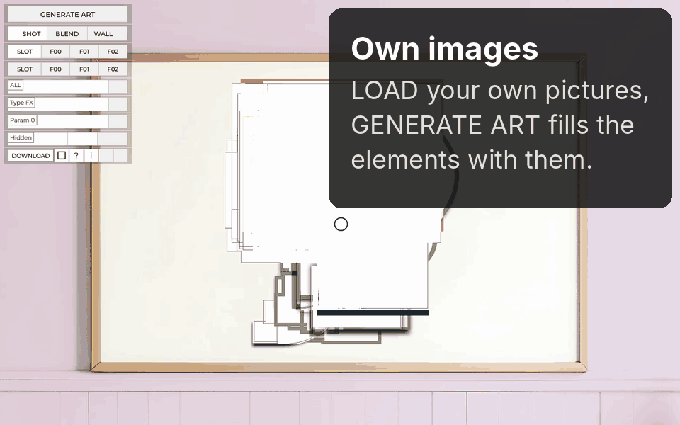</a></td>
        <td width="33%" valign="top"><a href="docs/demos/11-expert-mode.png">
        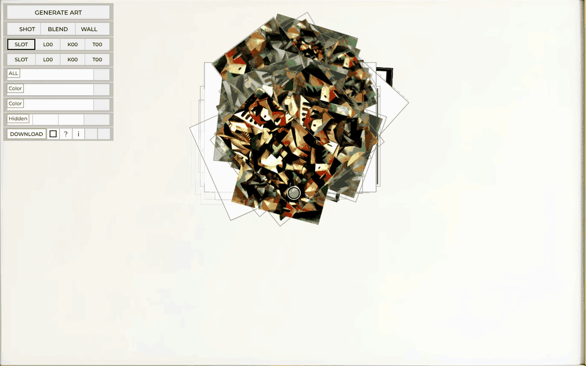</a></td>
        <td width="33%" valign="top"><a href="docs/demos/12-download.png">
        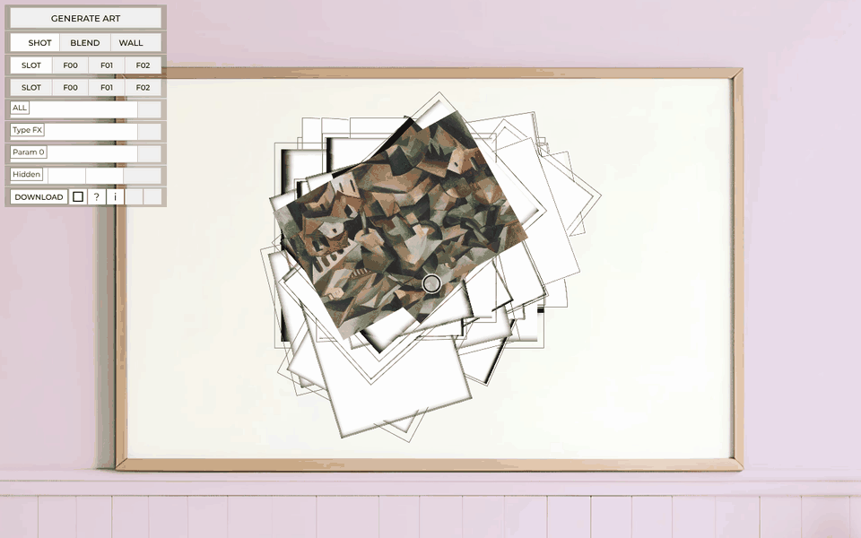</a></td>
    </tr>
</table>


## Installation
Artwork-WEB is a static frontend, but it still needs a web server: every asset
path starts with `/` and the page uses `fetch`, a Web Worker and an iframe, so
opening `index.html` as a file does not work. `readme.py` is a small server
built on the Python standard library (no `pip install`). It serves the local
files only, never connects anywhere, and maps `/cd/…` to the local `cdn/`
folder. It listens on `127.0.0.1` only, so it is not reachable from other
machines on your network.

**Requirements:** macOS or Linux (on Windows, use WSL), `python3` 3.7+, and a
current desktop browser with WebGL. The curl install also needs `curl` and
`tar`; a clone needs `git`.

#### Generic install (curl)
Downloads the full repo (~1.4 GB, the paintings and wall photos are part of
it) to `~/.local/share/artwork-web` (or `$XDG_DATA_HOME/artwork-web`) and adds
an `artwork-web` launcher to `~/.local/bin`. Nothing else on your system is
touched. As always with curl-into-sh: the script is short and readable, take a
look at [`install.sh`](install.sh) before you run it.

```bash
curl -fsSL https://raw.githubusercontent.com/andri-berger/artwork-web/main/install.sh | sh
artwork-web --open
```

If your shell says `artwork-web: command not found`, `~/.local/bin` is not on
your `PATH`. Add `export PATH="$HOME/.local/bin:$PATH"` to your shell config,
or run `~/.local/bin/artwork-web --open` directly.

**Update:** run the same curl command again. It downloads the whole repo again
and replaces the install folder, so don't keep your own edits in there. Your
artworks are not affected; they live in the browser (see
[Where your work is saved](#where-your-work-is-saved)).

**Uninstall:**

```bash
rm -rf ~/.local/share/artwork-web ~/.local/bin/artwork-web
```

#### From a clone (for working on it)
```bash
git clone https://github.com/andri-berger/artwork-web
cd artwork-web
python3 readme.py --open
```

Edits show up on reload; the server sends `Cache-Control: no-cache`.

#### Server options
`artwork-web` and `python3 readme.py` take the same options:

<table>
    <tr>
        <th align="left">Option</th>
        <th align="left">What it does</th>
    </tr>
    <tr>
        <td><kbd>--open</kbd></td>
        <td>Opens the page in your default browser.</td>
    </tr>
    <tr>
        <td><kbd>-p, --port PORT</kbd></td>
        <td>Port to start from (default <code>8000</code>, or the <code>PORT</code> environment variable). If it is taken, the next free port up to +19 is used.</td>
    </tr>
    <tr>
        <td><kbd>-q, --quiet</kbd></td>
        <td>Don't log every request.</td>
    </tr>
</table>

The server prints the URL it actually uses; stop it with Ctrl+C.

Always open the page via **http://localhost:PORT**, not `127.0.0.1`: the page
only accepts messages from its iframe on the `localhost` hostname, and the
canvas stays empty otherwise.

On a remote or headless machine, forward the port and open it locally, again
via `localhost`: `ssh -L 8000:localhost:8000 you@host`, then run
`artwork-web` on the host.

#### Optional: native capture in Chrome
By default the artwork is captured with `html-to-image`. Chrome can do this
natively with the experimental HTML-in-Canvas feature, which is behind a flag.
To try it without touching your normal Chrome profile:

```bash
artwork-web &        # or: python3 readme.py &
google-chrome --user-data-dir="$HOME/.cache/artwork-web-chrome" \
  --enable-features=CanvasDrawElement http://localhost:8000/
```

The result looks the same either way; the app falls back to `html-to-image`
by itself whenever native capture isn't available or fails.

#### Troubleshooting
<table>
    <tr>
        <th align="left">Symptom</th>
        <th align="left">Cause and fix</th>
    </tr>
    <tr>
        <td><kbd>Dashboard shows, but the canvas stays empty</kbd></td>
        <td>You opened <code>127.0.0.1</code> (or another hostname). Use <code>http://localhost:PORT</code>.</td>
    </tr>
    <tr>
        <td><kbd>Blank page or missing files</kbd></td>
        <td>You opened <code>index.html</code> as a file. Start the server and use the URL it prints.</td>
    </tr>
    <tr>
        <td><kbd>My artwork is gone after a restart</kbd></td>
        <td>Browser storage is per origin, and the port is part of it. If the server moved to another port (because 8000 was taken), your saved work is still under the old port. Free that port or pass <code>--port</code> to get it back.</td>
    </tr>
    <tr>
        <td><kbd>artwork-web: command not found</kbd></td>
        <td><code>~/.local/bin</code> isn't on your <code>PATH</code>, see above.</td>
    </tr>
    <tr>
        <td><kbd>Want a clean start</kbd></td>
        <td>Clear the site data for <code>localhost</code> in your browser.</td>
    </tr>
</table>

## How it works in one minute
The screen has two halves. The **dashboard** (buttons, sliders and, in Expert
Mode, a spreadsheet) is where you change things. The **canvas** shows the
result.

The artwork itself is a small web page that runs inside an iframe: three
families of elements called **L00**, **K00** and **T00** (up to 100 L00, 100
K00 and 1,000 T00 elements), laid out and styled with CSS. The spreadsheet
holds every one of their properties: size, position, order, margins, rotation,
blur, colors, gradients, blend modes, the painting they are filled with, and
so on. The sliders and GENERATE ART are shortcuts that fill this spreadsheet
for you with seeded random values.

When something changes, the iframe rebuilds the HTML, takes a picture of it,
runs the picture through the filters you picked, and shows that picture on the
canvas. [The full trace](#the-full-trace) below follows one edit through every
step.

## What you can do
Hover over any dashboard button or slider while the info screen (**i**) is on
and the app shows a short help text for it.

### Top buttons
<table>
    <tr>
        <th align="left">Button</th>
        <th align="left">What it does</th>
    </tr>
    <tr>
        <td><kbd>GENERATE ART</kbd></td>
        <td>Creates a new random artwork in one click. It reads the slider settings, rolls new seeds (unless a seed is locked) and refills the tables.</td>
    </tr>
    <tr>
        <td><kbd>SHOT</kbd></td>
        <td>Shot Mode. Shows the artwork as a rendered picture in a mockup room, with a wall behind it. Padding X/Y and canvas zoom only apply here.</td>
    </tr>
    <tr>
        <td><kbd>BLEND</kbd></td>
        <td>Blends the artwork into the wall (CSS <code>multiply</code>), as if it were printed on it.</td>
    </tr>
    <tr>
        <td><kbd>WALL</kbd></td>
        <td>Picks another room. There are 676 walls; the app prefers ones whose shape matches your window.</td>
    </tr>
    <tr>
        <td><kbd>SLOT</kbd></td>
        <td>Slot Mode. Shows the rendered picture full size, without the room. The best view for working on the FX filters.</td>
    </tr>
    <tr>
        <td><kbd>L00 / K00 / T00 (checkboxes)</kbd></td>
        <td>Lock the random seed of that element family, so GENERATE ART keeps it and only changes the rest.</td>
    </tr>
    <tr>
        <td><kbd>F00</kbd></td>
        <td>Circle Mode: the Granular filter draws circles instead of blocks (needs SLOT on).</td>
    </tr>
    <tr>
        <td><kbd>F01</kbd></td>
        <td>Stroke Mode: the Granular filter draws strokes instead of filled blocks (needs SLOT on).</td>
    </tr>
    <tr>
        <td><kbd>F02</kbd></td>
        <td>Vector Mode (PNG to SVG). Currently inert: it relied on a server-side converter that isn't part of this frontend.</td>
    </tr>
</table>

With both SHOT and SLOT off you get the **HTML view**: the live artwork page
itself, not a picture of it. This is the fastest view while editing, but the
FX filters don't show here.

### Slider panels
The two radio rows pick which slider panel you see. In every panel the first
slider scrolls through the panel's other sliders, two at a time. Drag a slider's
handle to change its value.

<table>
    <tr>
        <th align="left">Panel</th>
        <th align="left">What it controls</th>
    </tr>
    <tr>
        <td><kbd>SLOT (first row)</kbd></td>
        <td>Global settings: dashboard colors, padding, label size, stacking order, rotations, container width and height, morph and wave (SVG displacement) for everything, and two color palettes (dual colors per family, plus a 6-slot global palette).</td>
    </tr>
    <tr>
        <td><kbd>L00 / K00 / T00</kbd></td>
        <td>The randomizer for one element family: how many elements, how chaotic, average position and spread, how much of the painting fills them (Image A/B), rotation, shift, size, morph, wave and color intensity.</td>
    </tr>
    <tr>
        <td><kbd>SLOT (second row)</kbd></td>
        <td>Creative filter (PixiJS). The first slider picks one of 13 effects: Ascii, Noise, Dot, CRT, Simplex Noise, Glow, Kawase Blur, Advanced Bloom, Zoom Blur, Twist, Bulge/Pinch, Glitch, Reflection. The others tune it.</td>
    </tr>
    <tr>
        <td><kbd>F00</kbd></td>
        <td>Granular filter: block size, spacing, random offsets and stroke thickness. It redraws the picture as many small blocks, circles or strokes.</td>
    </tr>
    <tr>
        <td><kbd>F01</kbd></td>
        <td>Granular shapes for Circle and Stroke Mode: start, end, angle, curves and randomness of each shape.</td>
    </tr>
    <tr>
        <td><kbd>F02</kbd></td>
        <td>Glamour filter (oil painting, sketch, cartoon) and Vector Mode settings. Inert, like the F02 button.</td>
    </tr>
</table>

### Expert Mode: the spreadsheet
The last radio row opens the tables (Handsontable). The label shows where you
are: **Hidden**, **Format** or **Styling**.

<table>
    <tr>
        <th align="left">Tab</th>
        <th align="left">Rows × columns</th>
        <th align="left">What's in it</th>
    </tr>
    <tr>
        <td><kbd>1 · Format</kbd></td>
        <td>245 × 103</td>
        <td>The foundation. One column per element and 18 layout rows each: width, height, alignment, order, offset, margin, padding and which frame an element sits in.</td>
    </tr>
    <tr>
        <td><kbd>2 · Styling</kbd></td>
        <td>1,304 × 43</td>
        <td>One row per element: position, blur, 3D axes, outline, corner angles, slide, scale, rotation, origin and more.</td>
    </tr>
    <tr>
        <td><kbd>3 · Styling &amp; Colors</kbd></td>
        <td>1,304 × 42</td>
        <td>One row per element: shape, shade, border and outline fills, gradients, display, blend, drop shadow, brightness, opacity, grayscale, saturation, contrast and image shift.</td>
    </tr>
</table>

Cells outside an element's range are read-only, dropdown cells only accept their listed values, and
the placeholder in an empty cell tells you the expected unit (`px`, `%`,
`deg`, `#hex`, ...). Selecting a cell shows a short explanation with a link to
the MDN docs for that CSS property. Undo, redo, copy, paste and cut work as
usual, and every edit redraws the artwork right away.

### Bottom buttons
<table>
    <tr>
        <th align="left">Button</th>
        <th align="left">What it does</th>
    </tr>
    <tr>
        <td><kbd>DOWNLOAD</kbd></td>
        <td>Renders the artwork again at 5× screen resolution and saves it as <code>&lt;timestamp&gt;.png</code>. Ctrl+Alt+Meta inside the canvas does the same.</td>
    </tr>
    <tr>
        <td><kbd>Painting browser (frame icon)</kbd></td>
        <td>Browse 3,236 paintings by 100 artists (the <code>cdn/</code> folder). The painting you pick becomes the texture inside the elements. Use ↑/↓ for the artist and the arrow pair for the painting; the painting's title links to the full image.</td>
    </tr>
    <tr>
        <td><kbd>?</kbd></td>
        <td>Use your own images. <b>LOAD</b> picks up to 100 image files; they are kept in IndexedDB and replace the paintings in the browser. Cancel the picker to go back to the paintings.</td>
    </tr>
    <tr>
        <td><kbd>i</kbd></td>
        <td>Info screen with a short tour of the app, and hover help for every control.</td>
    </tr>
    <tr>
        <td><kbd>Last two buttons</kbd></td>
        <td>Move the dashboard up/down and left/right.</td>
    </tr>
    <tr>
        <td><kbd>X / GO!</kbd></td>
        <td>In the browser: close it, or jump to the next artist.</td>
    </tr>
</table>

### Where your work is saved
Everything stays in your browser, for this site only:

- `localStorage` key `IC` holds the UI: slider values, toggles, the open
  panel, the wall and the painting position.
- `localStorage` key `ID` holds seeds and palette colors, and `IB` remembers
  which painting you last used per artist.
- IndexedDB database `IB` holds the spreadsheet edits and your uploaded
  images.

On load the app reads all of this back and redraws the same artwork. A
damaged `localStorage` entry is dropped instead of breaking the app. To start
fresh, clear the site data for `localhost` in your browser.

Browser storage is tied to the origin, and the port is part of it:
`localhost:8000` and `localhost:8001` have separate saved work. Updating or
reinstalling the files does not touch it.

## The full trace
What happens between typing a value into a cell and seeing it on the canvas:

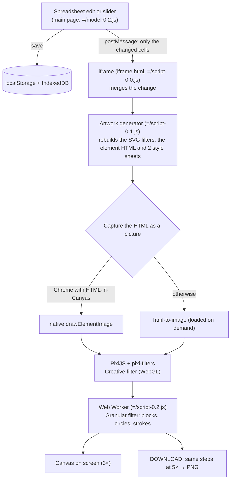

Step by step, in plain words:

1. **You change something.** A cell edit, a slider or GENERATE ART on the main
   page turns into a small list of changed values. The main page saves it
   (`localStorage` and IndexedDB) and sends only that change to the iframe with
   `postMessage`. The iframe only listens on `localhost`, which is why
   `127.0.0.1` doesn't work.
2. **The iframe rebuilds the artwork page.** It merges the change into its
   copy of the tables, and the generator writes new HTML: an `<svg>` with
   morph and wave filters, the `<div>` tree of L00/K00/T00 elements and two
   `<style>` sheets. Depending on which table changed, only the affected parts
   are rewritten. The artwork is then centered.
3. **It takes a picture of that page.** Where the browser supports
   HTML-in-Canvas (`drawElementImage`), the page is drawn natively into a
   canvas, after waiting for images and fonts. Otherwise, or if that fails,
   times out or comes out blank, it loads `html-to-image` and uses that
   instead. Both give the same result (they differ in under 0.15% of pixels).
   The picture is taken at 3× for the screen and 5× for DOWNLOAD, then cropped
   to the artwork plus padding.
4. **WebGL filters.** If a Creative filter is chosen, PixiJS puts the picture
   on a sprite, applies the filter and reads the result back.
5. **Pixel filter.** If Granular settings are on, a Web Worker repaints the
   picture as blocks, circles or strokes on an OffscreenCanvas, sampling the
   color underneath each one.
6. **Show or save.** The final picture goes onto the canvas you see (SHOT or
   SLOT), or into a PNG file (DOWNLOAD).

Each stage keeps its result. If you only move a filter slider, the app reruns
the stages from that filter on and reuses the earlier picture, which keeps
dragging smooth. Captures that pile up while you drag are merged, so only the
latest one is drawn.

## File layout
Everything is plain static files. Paths are absolute from the site root
(`/=/`, `/@/`, ...), which is why it needs `readme.py`. The original
unminified sources are lost, so the files in `=/` are minified and are the
source.

<table>
    <tr>
        <th align="left">Path</th>
        <th align="left">What's in it</th>
    </tr>
    <tr>
        <td><kbd>index.html</kbd></td>
        <td>The main page: dashboard, tables and the iframe.</td>
    </tr>
    <tr>
        <td><kbd>iframe.html</kbd></td>
        <td>The artwork page that gets rendered.</td>
    </tr>
    <tr>
        <td><kbd>readme.py, install.sh</kbd></td>
        <td>Local server and the curl installer (see Installation).</td>
    </tr>
    <tr>
        <td><kbd>frame.js</kbd></td>
        <td>Service worker stub; only registers on print-artwork.com.</td>
    </tr>
    <tr>
        <td><kbd>=/model-0.2.js</kbd></td>
        <td>Main page logic: buttons, sliders, tables, saving and the messages to the iframe.</td>
    </tr>
    <tr>
        <td><kbd>=/model-0.0.js, =/model-0.1.js</kbd></td>
        <td>Data: help texts, table layouts and dropdown values, the painting catalog, the wall list.</td>
    </tr>
    <tr>
        <td><kbd>=/script-0.0.js</kbd></td>
        <td>iframe renderer: capture, PixiJS filters, worker, display and download.</td>
    </tr>
    <tr>
        <td><kbd>=/script-0.1.js</kbd></td>
        <td>Artwork generator: turns the tables into SVG, HTML and CSS.</td>
    </tr>
    <tr>
        <td><kbd>=/script-0.2.js</kbd></td>
        <td>Web Worker for the Granular filter.</td>
    </tr>
    <tr>
        <td><kbd>=/style-0.1.css, =/style-0.0.css</kbd></td>
        <td>Styles for the main page and the iframe.</td>
    </tr>
    <tr>
        <td><kbd>=/bundle/</kbd></td>
        <td>Blank placeholder images.</td>
    </tr>
    <tr>
        <td><kbd>@/</kbd></td>
        <td>Third-party libraries (see below). <code>@/bundle/</code> holds the Montserrat font, <code>@/bundles/</code> the app icons.</td>
    </tr>
    <tr>
        <td><kbd>cdn/</kbd></td>
        <td>3,236 paintings by 100 artists (AVIF), one folder per artist. Served as <code>/cd/</code> too.</td>
    </tr>
    <tr>
        <td><kbd>fonts/</kbd></td>
        <td>Full-size wall photos for SHOT/WALL. Despite the name, there are no fonts in here.</td>
    </tr>
    <tr>
        <td><kbd>frame/</kbd></td>
        <td>Small previews of the same walls, shown while the full one loads.</td>
    </tr>
    <tr>
        <td><kbd>cdns/</kbd></td>
        <td>Product mockup photos from the former print shop.</td>
    </tr>
</table>

## Built with
These libraries ship in `@/`, unchanged:

<table>
    <tr>
        <th align="left">Library</th>
        <th align="left">Version</th>
        <th align="left">Used for</th>
        <th align="left">License</th>
    </tr>
    <tr>
        <td><kbd><a href="https://github.com/handsontable/handsontable">Handsontable</a></kbd></td>
        <td>12.0.0</td>
        <td>The spreadsheet in Expert Mode</td>
        <td>Proprietary, used under its free non-commercial license</td>
    </tr>
    <tr>
        <td><kbd><a href="https://github.com/pixijs/pixijs">PixiJS</a></kbd></td>
        <td>8.10.1</td>
        <td>WebGL rendering (<code>@/pixi-filter-8.10.1.js</code>)</td>
        <td>MIT</td>
    </tr>
    <tr>
        <td><kbd><a href="https://github.com/pixijs/filters">pixi-filters</a></kbd></td>
        <td>6.1.3</td>
        <td>The 13 Creative filters</td>
        <td>MIT</td>
    </tr>
    <tr>
        <td><kbd><a href="https://github.com/bubkoo/html-to-image">html-to-image</a></kbd></td>
        <td>1.11.13</td>
        <td>Capture fallback when HTML-in-Canvas isn't available</td>
        <td>MIT</td>
    </tr>
    <tr>
        <td><kbd><a href="https://github.com/d3/d3-random">d3-random</a></kbd></td>
        <td>3.0.1</td>
        <td>Seeded random numbers, so a seed always gives the same artwork</td>
        <td>ISC</td>
    </tr>
    <tr>
        <td><kbd><a href="https://github.com/JulietaUla/Montserrat">Montserrat</a></kbd></td>
        <td>9.000</td>
        <td>Dashboard font</td>
        <td>SIL OFL 1.1</td>
    </tr>
    <tr>
        <td><kbd><a href="https://github.com/WICG/html-in-canvas">HTML-in-Canvas</a></kbd></td>
        <td>(browser API)</td>
        <td>Native capture of the artwork page</td>
        <td>—</td>
    </tr>
</table>

## License
This project's own code is licensed under the GNU General Public License v3.0,
see [`LICENSE`](LICENSE).

**Third-party note.** That license covers this project's own code only.
It does not cover the libraries above, which keep their own licenses.
Handsontable in particular is not open source: it is free for non-commercial
use only, and commercial use needs a license from Handsoncode. The paintings in
`cdn/` are reproductions of artworks that are mostly in the public domain. The
wall and mockup photos have their own terms, separate from the code license.

## Inspiration
No code, purely visual debts. The Pinterest board is the moodboard this tool
was built to chase, and print-artwork.com is the commercial ancestor that
artwork-web and its sibling projects were carved out of.

- Pinterest: https://de.pinterest.com/andriberger/_saved
- Artwork: https://print-artwork.com
